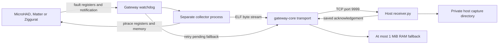

# Gateway crash snapshots

This guide covers signal-triggered userspace ELF cores for MicroHAD, Matter and
Ziggurat. See the [implementation README](../scripts/core-capture/README.md) for
wire framing, memory bounds, supported signals and detailed failure behavior.
Commands below run on the development host from the repository root, using Bash,
unless explicitly marked **gateway**.

## Architecture

The running stock 3.10.90 kernel can load ELF programs but has no ELF core-dump
writer. Its own kernel image contains a null core callback in the ELF loader.
This feature bypasses that missing writer without replacing or patching the
kernel. The replacement kernels in rtl8196e-gateway are unrelated to this finding.



Each instrumented process registers private shared state under
`/tmp/gateway-snapshots`. Its thread wrapper records application thread IDs and
installs alternate signal stacks. On SIGSEGV or SIGILL, the handler saves the
original fault registers, sends a nonblocking notification through a pre-opened
socket, and stops the faulting task. It performs no allocation or network setup.

On stock uClibc, register fatal handlers through `__libc_sigaction` rather than
the LinuxThreads `sigaction` wrapper. The wrapper derives its thread descriptor
from the stack pointer and can fault on the alternate stack before invoking the
application handler. Handler writes (including the collector notification) use
`SYS_write` directly to avoid the same lookup in cancellation wrappers. Verify
both main-thread and worker-thread faults with a dynamically linked disposable
probe against the stock runtime; a static-only probe does not cover this path.

The watchdog launches a separate collector, which stops the application's other
tasks and reads their registers and memory through `ptrace` and `/proc`. This
includes the stock LinuxThreads manager and workers, which have separate process
IDs and are not all listed under `/proc/PID/task`. The resulting big-endian MIPS
ELF core contains thread registers, writable readable memory, and mapping
descriptors. Matching executable/library files supply omitted read-only bytes.

The collector streams through `gateway-core` to the host receiver. There is no
dump byte-size limit. A **120-second watchdog** bounds the collection attempt and
releases service recovery if collection stalls. After collection, held tasks are
killed and the existing supervisor restarts the application. Consequently, a
captured SIGSEGV can appear as shell exit **137**: consult the core and snapshot
log for the original signal. An ordinary exit or SIGKILL/OOM kill is not captured.

The gateway keeps at most one **1 MiB serialized prefix** in private RAM as a
fallback. It retries every 30 seconds and removes pending data after the host
acknowledges saving it. A large fallback is explicitly truncated. Interrupted
prefixes are trimmed to complete frames before retry. Gateway reboot loses RAM
fallbacks; successfully received host files remain on host storage. No dump is
written to gateway flash. Firmware radio tracing stays disabled.

## Build and activate

The tracked default is `CRASH_SNAPSHOTS=false`. Set the following assignment in
private, gitignored `workspace.local.env` to enable this workspace persistently:

```sh
CRASH_SNAPSHOTS=true
```

This workspace already has it set to `true`. An environment assignment or Make
command-line assignment overrides the file for a particular build. The flag
controls all three target binaries; host MicroHAD test binaries remain
uninstrumented. Changing the flag invalidates the relevant build outputs.

Follow [build setup](building.md) for dependencies and toolchains, then build:

```bash
. scripts/workspace-env.sh
workspace_load "$PWD"
. scripts/toolchains.sh

make -C microhad host test
make -C microhad mips
ZIGGURAT_MULTIPAN=1 bash ziggurat/scripts/build.sh
bash micro-thread-matter-daemon/scripts/build.sh mips service
bash scripts/core-capture/build.sh
```

For example, `CRASH_SNAPSHOTS=false ZIGGURAT_MULTIPAN=1 bash ziggurat/scripts/build.sh`
disables the client for that build while retaining the shared-radio variant. Rebuild all three services with the intended setting before
releasing the stack.

Install the host receiver and run the disposable feasibility demo first. Replace
`HOST_LAN_IP` below with the development host's reachable LAN IPv4 address:

```bash
receiver_ip=HOST_LAN_IP
python3 scripts/core-capture/install-host.py --bind "$receiver_ip" --gateway "$GATEWAY_IP"
python3 scripts/core-capture/test-snapshot-device.py --host "$GATEWAY_IP" --receiver "$receiver_ip"
```

The full demo deliberately crashes disposable processes, checks the cores in
MIPS GDB, and tests collector death and the 120-second recovery deadline. Run it
before activation: it requires that the production collector is not already
listening. It does not deliberately crash any of the three production services.

Only deploy when a device update is intended. Stage the helpers, destination and
runtime enable marker, then use the guarded selective deployment flow:

```bash
python3 scripts/core-capture/deploy.py --host "$GATEWAY_IP" --receiver "$receiver_ip" --stage-only
./deploy.sh --services native,matter,ziggurat,supervisor --target /tuya/native \
  --binary "microhad/build/${TARGET_BUILD_SUBDIR}mips-ziggurat-matter/microhad" \
  --matter-service "build/${TARGET_BUILD_SUBDIR}micro-thread-matter-daemon/mthread-matter-mips" \
  --ziggurat "build/${TARGET_BUILD_SUBDIR}ziggurat-hdlc/${TARGET_SPEC_NAME}/release/ziggurat.stripped"
```

Helper staging does not restart services. The paired supervisor starts the
collector before the applications after activation. On the **gateway**,
`/tuya/native/core-capture.conf` contains the receiver's `IPv4 PORT`, and
`/tuya/native/core-snapshots.enabled` contains `true` or `false`. These installed
files survive reboot. Set the runtime marker to `false` and restart the paired
supervisor to disable capture; rebuild with the flag disabled to remove the
instrumentation from binaries. Follow [deployment](deployment.md) for restart,
state-preservation and flash-space safeguards.

## Host receiver deployment and reboot persistence

The installer creates `build/gateway-core-receiver.service` and enables it as a
**systemd user service** for the invoking user. It links the unit into
`~/.config/systemd/user/` and that user's `default.target.wants/`, starts it, and
enables user lingering with `loginctl enable-linger`. It is a host process,
separate from the gateway and the syslog collector; no Docker container is used.

The service runs the repository's `scripts/core-capture/receiver.py` with explicit
bind address, allowed gateway address and output directory. It uses `UMask=0077`,
`Restart=always` and `RestartSec=5`. The default port is 9999; installation and
staging accept `--port` for another port.

Manage or inspect it on the host:

```sh
systemctl --user status gateway-core-receiver.service
systemctl --user is-enabled gateway-core-receiver.service
systemctl --user cat gateway-core-receiver.service
journalctl --user -u gateway-core-receiver.service -n 50 --no-pager
loginctl show-user "$(id -un)" -p Linger
ss -ltn 'sport = :9999'
# Load a changed receiver implementation or retry startup now:
systemctl --user restart gateway-core-receiver.service
# Stop and disable automatic startup:
systemctl --user disable --now gateway-core-receiver.service
```

With the unit enabled and `Linger=yes`, systemd starts the receiver's user manager
at host boot without requiring login and keeps it after logout. This is configured
on the current development machine. Its `/media/steamlibrary` filesystem is an
active systemd mount generated from `/etc/fstab`. Reboot persistence has been
checked through the mount configuration, enabled unit and linger settings; no host reboot was performed as a test.

The generated unit and Python source remain inside the repository. The repository
filesystem must be mounted at its configured path after reboot; deleting `build/`,
moving the checkout, or leaving its filesystem unmounted prevents startup. Keep
that filesystem mounted automatically, and rerun the installer if paths change.
If the LAN address is not yet available, the service retries every five seconds.
A changed host/gateway IP requires rerunning the installer and staging the updated
gateway destination. Host disk space, LAN connectivity and firewall access to
the selected TCP port are also required. There is no automatic host dump rotation.

## Obtain and identify captures

Captures arrive automatically under the host repository's
`diagnostics/core-dumps/`. No manual copy from gateway flash is needed. Each
capture has a unique directory containing:

| File | Meaning |
| --- | --- |
| `capture.json` | PID, original signal, epoch, peer, completion status and byte count; failures can include an error |
| `process.txt` | Executable pathname and bounded `/proc/PID/maps` text |
| `core` | Completed ELF core |
| `core.truncated` | A completed transfer of an explicitly incomplete snapshot/prefix |
| `core.partial` | Interrupted transfer; no completed-core claim |

List and inspect captures without dumping their potentially sensitive contents:

```sh
find diagnostics/core-dumps -mindepth 2 -maxdepth 2 -name capture.json -print
cat diagnostics/core-dumps/CAPTURE_DIRECTORY/capture.json
cat diagnostics/core-dumps/CAPTURE_DIRECTORY/process.txt
```

Use `process.txt` to distinguish a real service crash from the intentional
`snapshot-demo`/`probe` crashes used during verification. A lost acknowledgement
can produce duplicate captures. Keep cores private and out of Git: memory can
contain credentials, keys, device information and packet data. The output
already lives under ignored `diagnostics/`.

When capture is missing, check host service status and journal, gateway
`gateway-snapshot`/`gateway-core` syslog messages, the original service stderr
tag, and supervisor restart events. On the **gateway**:

```sh
cat /tmp/gateway-snapshots/daemon.pid
ls -l /tmp/gateway-snapshots/job.*
ls -l /tmp/gateway-core-capture/
cat /tmp/ziggurat-supervisor/matter.events
```

A registration file alone is not a core. Missing collector startup leaves
applications running without snapshots. The supervisor recovers armed jobs and
reconnects clients after unexpected watchdog death. Concurrent crashes may be
skipped because only one collection runs at a time. A truncated prefix can
contain useful register notes but may be rejected by GDB.

## Evaluate a core in GDB

Always use the **exact matching unstripped executable and target runtime
libraries**, not whichever binaries were built most recently. Save them before
the next deployment. Normal build outputs are:

| Service | Matching unstripped ELF |
| --- | --- |
| MicroHAD | `microhad/build/${TARGET_BUILD_SUBDIR}mips-ziggurat-matter/microhad.elf` |
| Matter | `build/${TARGET_BUILD_SUBDIR}micro-thread-matter-daemon/target/${TARGET_SPEC_NAME}/release/mthread-matter` |
| Ziggurat | `build/${TARGET_BUILD_SUBDIR}ziggurat-hdlc/${TARGET_SPEC_NAME}/release/ziggurat` |

The deployed snapshot-enabled build has private matching artifacts under
`diagnostics/userspace-snapshots-20261029/`: `microhad.elf`, `mthread-matter.elf`,
`ziggurat.elf`, `sysroot/lib/` and a manifest with source revision and hashes.
Treat that directory as an example archive for this deployment, not a match for
future releases. The demo retains its own matching ELF alongside its captures.

Use a debugger that supports big-endian MIPS. The RSDK `mips-linux-gdb` was used
for the feasibility checks; a compatible `gdb-multiarch` is another option. An
ordinary x86-only host GDB cannot decode these cores. For the archived Matter
build, select a capture directory and run:

```bash
. scripts/toolchains.sh
snapshot_archive="$PWD/diagnostics/userspace-snapshots-20261029"
capture="$PWD/diagnostics/core-dumps/CAPTURE_DIRECTORY"
"${TARGET_TOOLCHAIN_ROOT}/bin/${TARGET_PREFIX}gdb" \
  -ex "set sysroot $snapshot_archive/sysroot" \
  -ex "file $snapshot_archive/mthread-matter.elf" \
  -ex "core-file $capture/core"
```

Select `microhad.elf` or `ziggurat.elf` for those services. Useful GDB commands:

```text
info threads
info registers
x/12i $pc-16
bt full
thread apply all bt full
frame 0
info args
info locals
info sharedlibrary
```

Start with the selected faulting thread and its original PC, then inspect caller
frames and other threads for invalid pointers, damaged stacks or lock ownership.
Correlate with the capture epoch, original signal and syslog around the crash.
The other threads' registers are from when the collector stopped them; memory
is not an atomic image of the instant the first fault happened. Optimized code
can leave variables unavailable, old debuggers may have limited Rust support,
and damaged stacks can prevent unwinding. Check matching symbols and libraries
before interpreting an unresolved frame as stack corruption.
