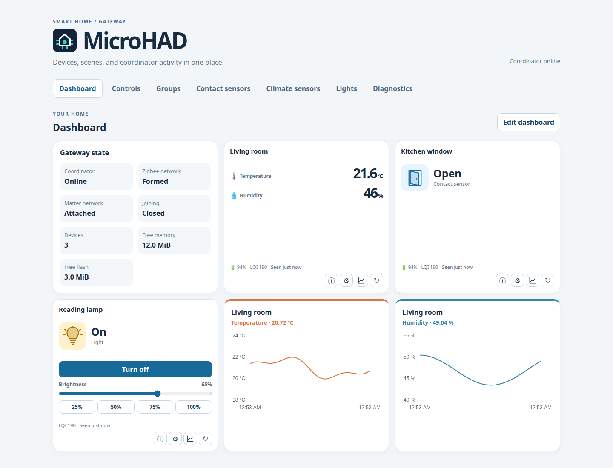
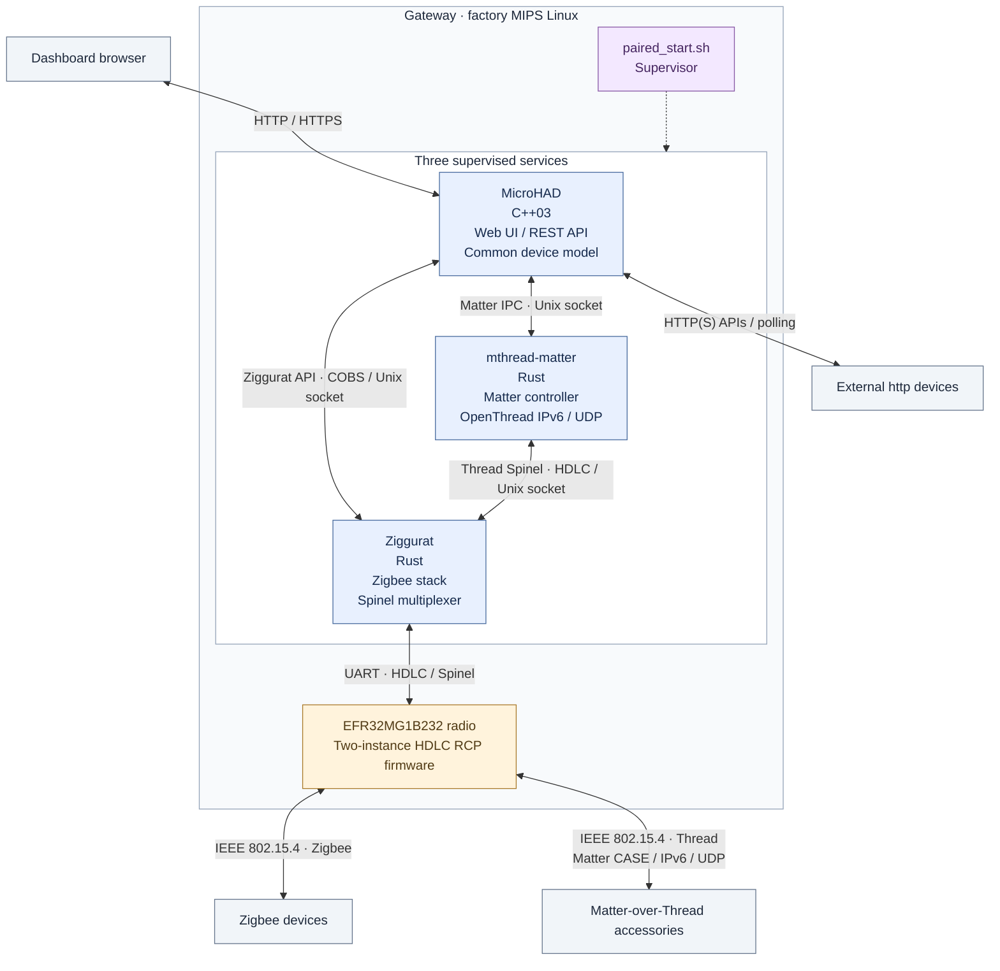
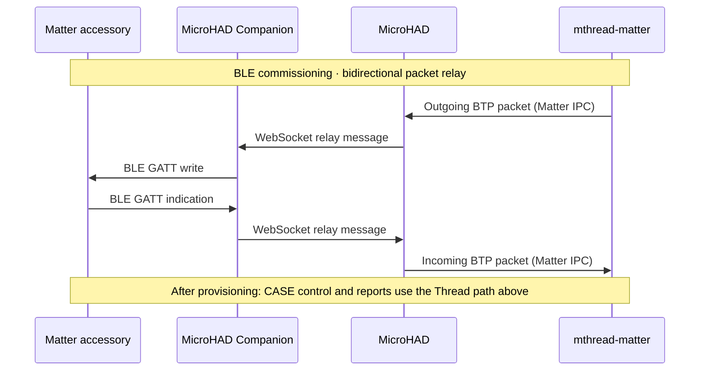

# Embedded home automation without an external host

A standalone home automation stack that runs directly on embedded devices such
as the Lidl/Silvercrest SGWZ 1 A1 Zigbee gateway (HG06339). Features include:

- A local web dashboard
- Device control
- [Lua automation scripts](docs/scripting.md) with device events, timers and schedules
- Sensor history
- Browser Push and FCM Notifications
- An [Android companion app](docs/companion-app.md) for Matter setup and push alerts
- Zigbee and Matter-over-Thread support
- HTTP integrations for external devices: Shelly Gen 1 and Fritz!Box (as presence sensor)

Control lights and scenes, view temperature and humidity history, and receive
alerts when a window stays open. See [usage](docs/native-usage.md).



Dashboard shown with demo data.

## Project status

> [!WARNING]
> **This is a proof of concept / prototype, not production-ready software.**
>
> This entire project has been vibe coded. I have not meaningfully reviewed the
> code; my involvement has mainly been high-level architectural decisions.
>
> **The same applies to the documentation:** it has not been thoroughly reviewed
> and may contain errors or omissions.

## Thanks

Special thanks to [Paul Banks](https://paulbanks.org/projects/lidl-zigbee/) for
the Lidl gateway root-access work that made this project possible.

Even though it currently runs on the stock firmware, this project would not
have been possible without
[`rtl8196e-gateway`](https://github.com/jnilo1/rtl8196e-gateway), maintained by
[jnilo1](https://github.com/jnilo1), and the work of its contributors.

Thank you to the maintainers and contributors of the major upstream projects
used here: [Ziggurat](https://github.com/zigpy/ziggurat),
[rs-matter](https://github.com/project-chip/rs-matter),
[OpenThread](https://github.com/openthread/openthread),
[Mbed TLS](https://github.com/Mbed-TLS/mbedtls),
[Lua](https://www.lua.org/), and
[nanopb](https://github.com/nanopb/nanopb), as well as their respective
communities and all other upstream contributors.

This project is not affiliated with Lidl, Silvercrest or Tuya.

## Getting started

See the [documentation index](docs/README.md) for setup, usage, deployment,
recovery and developer guides. Configure your development machine with the
[shared host settings](docs/workspace-settings.md). Check [supported devices](docs/supported-devices.md)
for available features and compatibility limits.

The tested hardware is the Silvercrest SGWZ 1 A1 (HG06339) with an RTL8196E CPU,
EFR32MG1B232 radio and factory Linux. Other embedded devices might work, but are not tested. 
First installation requires opening the case, a 3.3 V USB-to-UART
adapter, root access, Ethernet and a Linux computer. Using Ziggurat and Matter requires
changing the radio firmware.

1. Check your hardware and follow the [installation guide](docs/installation.md)
   to obtain root access and make backups. For an existing Zigbee network, use
   the [migration guide](docs/ziggurat-deployment-plan.md).
2. Choose your setup and use a [binary release and its SSH installer](docs/binary-releases.md),
   or [build from source](docs/building.md). Binary bundles support MicroHAD-only
   with compatible stock EZSP firmware or the separately prepared Ziggurat/Matter stack.
   Follow the installation guide for root access, backups and radio prerequisites.
3. Open `http://<gateway-ip>/`, pair a device, and check its readings or controls.

Components:

| Component | Purpose |
| --- | --- |
| [MicroHAD](microhad/README.md) | C++03 daemon, Web UI and REST API; owns the common device model, controls, history, alerts and integrations with external HTTP devices. |
| [Ziggurat](ziggurat/README.md) (optional) | Rust Zigbee stack and Spinel multiplexer; connects MicroHAD and Thread to the shared radio and is the sole owner of the radio UART. |
| [mthread-matter](micro-thread-matter-daemon/README.md) (optional) | Rust Matter controller using rs-matter and userspace OpenThread; owns commissioning, fabrics, sessions, subscriptions and Thread state. |
| [Firmware](firmware/README.md) (optional, needed for Ziggurat and mthread-matter) | Rebuildable two-instance HDLC radio firmware, packaging and radio maintenance tools. |
| [paired_start.sh](microhad/paired_start.sh) | Starts, monitors and recovers MicroHAD, Ziggurat and mthread-matter as separate processes. The default configuration enables both optional services with `ZIGGURAT=1 MATTER=1`. |

## Processes and protocol paths

The diagram shows application data paths in the default paired stack. The
dotted supervisor link represents process management.



| Link | Default socket | Protocol |
| --- | --- | --- |
| MicroHAD ↔ Ziggurat | `/tmp/ziggurat/native.sock` | COBS-framed Ziggurat API v2 |
| MicroHAD ↔ Matter service | `/tmp/microhad-matter.sock` | Length-prefixed protobuf IPC v3 |
| OpenThread ↔ Ziggurat | `/tmp/ziggurat/thread.sock` | HDLC-encoded Spinel; client IID 0 is mapped to radio IID 2 |

Zigbee and Thread share the radio through a patched Ziggurat. OpenThread runs inside
`mthread-matter` and provides IPv6/UDP without requiring Linux IPv6 or TUN.

The companion Android app uses the phone’s Bluetooth connection to commission
Matter devices onto the gateway’s Thread network. Alternatively, Matter devices can be commissioned from the Web UI  using Chrome on Android.



## Build

See [build setup](docs/building.md) for prerequisites and build instructions.

```sh
# Build MicroHAD for the host and run tests
make -C microhad host test

# Build MicroHAD for the gateway
make -C microhad mips

# Build the web dashboard
make -C microhad webui

# Build Ziggurat with shared Zigbee/Thread radio support
ZIGGURAT_MULTIPAN=1 bash ziggurat/scripts/build.sh

# Build the Matter daemon for the gateway
bash micro-thread-matter-daemon/scripts/build.sh mips service

# Build the radio access and bootloader maintenance helper
bash firmware/scripts/build-maintenance.sh
```

To build without RSDK, first run `python3 scripts/build-toolchain.py`, then
select `TOOLCHAIN=crosstool-ng` for the target commands above (for example,
`make -C microhad TOOLCHAIN=crosstool-ng mips`). Crosstool-NG artifacts use separate
`build/crosstool-ng/` directories. See [toolchain selection](config/TOOLCHAINS.md)
for commands, source credits and compatibility limits.

## Repository layout

Root `scripts/`, `config/` and `patches/` contain shared build infrastructure,
compatibility patches and cross-service validation.

## Installation and deployment

See the [installation guide](docs/installation.md) to prepare the gateway.
Use `./deploy.sh` to upload the software, then activate and restart it as
described in the guide.

## Validation and current limits

See [native usage](docs/native-usage.md), [Matter runtime](docs/matter-service-runtime.md),
and [recovery tooling](docs/recovery-tooling.md).

## License and attribution

Original project code and documentation are licensed under the [MIT License](LICENSE),
Copyright (c) 2026 MicroHAD contributors. Third-party code, assets and upstream-derived
modifications retain their respective licenses; the root license does not relicense them.
See [third-party software and release obligations](THIRD_PARTY.md).
