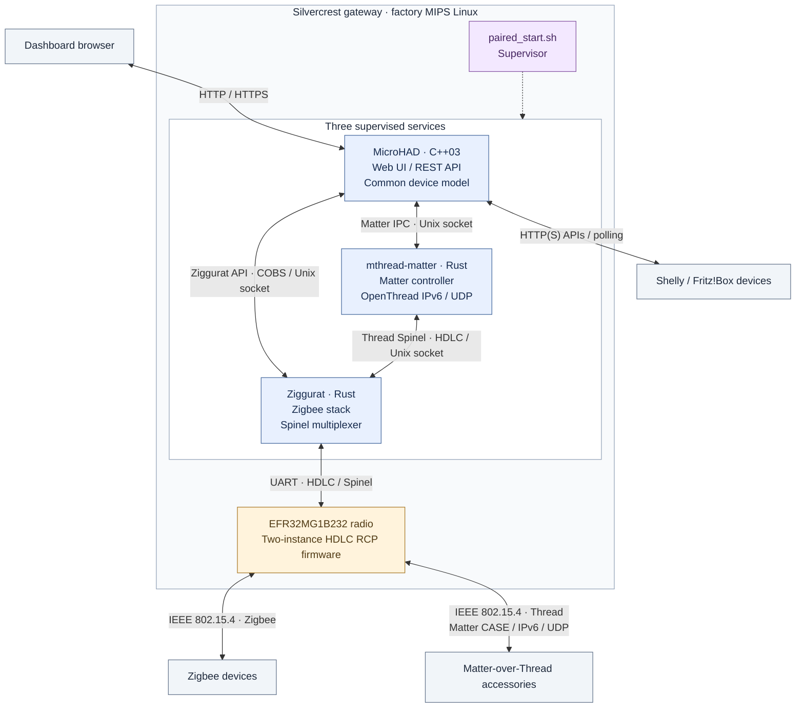
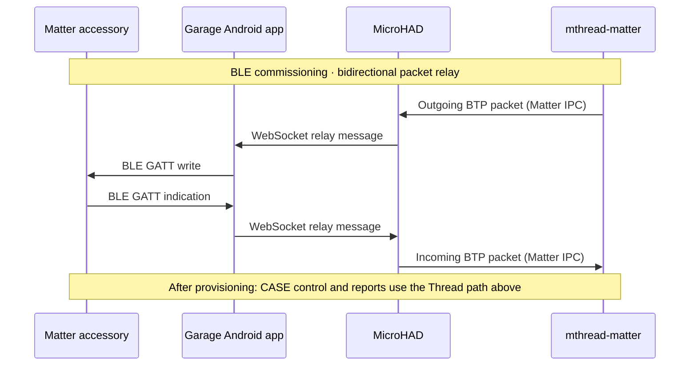

# Embedded home automation without an external host

A standalone home automation stack that runs directly on embedded devices such
as the Lidl/Silvercrest SGWZ 1 A1 Zigbee gateway (HG06339). Features include:

- A local web dashboard
- Device control
- Sensor history
- Notifications
- Zigbee and Matter-over-Thread support
- HTTP integrations with Shelly and Fritz!Box devices

Components:

| Component | Purpose |
| --- | --- |
| [MicroHAD](microhad/README.md) | C++03 daemon, Web UI and REST API; owns the common device model, controls, history, alerts and integrations with external HTTP devices. |
| [Ziggurat](ziggurat/README.md) (optional) | Rust Zigbee stack and Spinel multiplexer; connects MicroHAD and Thread to the shared radio and is the sole owner of the radio UART. |
| [mthread-matter](micro-thread-matter-daemon/README.md) (optional) | Rust Matter controller using rs-matter and userspace OpenThread; owns commissioning, fabrics, sessions, subscriptions and Thread state. |
| [Firmware](firmware/README.md) (optional) | Rebuildable two-instance HDLC radio firmware, packaging and radio maintenance tools. |
| [paired_start.sh](microhad/paired_start.sh) (optional) | Starts, monitors and recovers MicroHAD, Ziggurat and mthread-matter as separate processes. The default configuration enables both optional services with `ZIGGURAT=1 MATTER=1`. |

## Processes and protocol paths

The diagram shows application data paths in the default paired stack. The
dotted supervisor link represents process management.



The private socket paths below are launcher defaults and can be overridden.

| Link | Default socket | Protocol |
| --- | --- | --- |
| MicroHAD ↔ Ziggurat | `/tmp/ziggurat/native.sock` | COBS-framed Ziggurat API v2 |
| MicroHAD ↔ Matter service | `/tmp/microhad-matter.sock` | Length-prefixed CBOR IPC v2 |
| OpenThread ↔ Ziggurat | `/tmp/ziggurat/thread.sock` | HDLC-encoded Spinel; client IID 0 is mapped to radio IID 2 |

The radio UART runs at 460800 baud with hardware RTS/CTS flow control. Zigbee
uses radio IID 1; Thread uses IID 2. Matter control and subscription
reports travel through OpenThread, the Thread socket, Ziggurat and the shared
radio. OpenThread supplies IPv6/UDP inside `mthread-matter`; this path does not
need Linux IPv6 or TUN and does not make the gateway an OTBR. Zigbee, Matter and
external HTTP integrations all feed MicroHAD's common device model.

During BLE commissioning, the Garage Android app supplies the phone's GATT
connection to the accessory. MicroHAD relays its packets over the Matter IPC
socket; the Matter service owns BTP, PASE and Thread provisioning. This relay
uses the plain WebSocket endpoint `/api/matter/relay` on MicroHAD's HTTP
listener; it is not served by the HTTPS listener.



The Garage app's local checkout lives in `garage-app/`, is ignored here, and
retains its own Git repository and credentials. The commissioning flow is
implemented and covered by synthetic fixtures; physical accessory acceptance
remains open as described under [validation and current limits](#validation-and-current-limits).

## Build

Use an x86_64 Linux development host. Gateway builds support RSDK (the
production default) or experimental crosstool-NG built from source without RSDK;
host builds need neither SDK. Shared defaults live in `config/toolchains.mk`.
See [build setup](docs/building.md) for prerequisites and firmware tooling.
From the repository root:

```sh
make -C microhad host test
make -C microhad mips
make -C microhad webui
ZIGGURAT_MULTIPAN=1 bash ziggurat/scripts/build.sh
bash micro-thread-matter-daemon/scripts/build.sh mips service
bash firmware/scripts/build-maintenance.sh
bash microhad/scripts/build-logread.sh
```

To build without RSDK, first run `python3 scripts/build-toolchain.py`, then
select `TOOLCHAIN=crosstool-ng` for the target commands above (for example,
`make -C microhad TOOLCHAIN=crosstool-ng mips`). Candidate artifacts use separate
`build/crosstool-ng/` directories. See [toolchain selection](config/TOOLCHAINS.md)
for commands, source credits and compatibility limits. Deployment defaults
continue to select RSDK artifacts.

MicroHAD defaults to `ZIGGURAT=1 MATTER=1`. An EZSP-only setup remains available
with `ZIGGURAT=0`; `ZIGGURAT=1 MATTER=0` builds Zigbee without Matter.
Home Assistant ZHA can alternatively use the radio through a serial bridge or
Ziggurat WebSocket connection. Those setups use ZHA as the coordinator client.

## Repository layout

Each component owns its source, scripts, patches, tests and dependencies.
Upstream Ziggurat is pinned under `ziggurat/dependencies/ziggurat`; rs-matter
under `micro-thread-matter-daemon/dependencies/rs-matter`; the firmware dependencies under
`firmware/dependencies/`. Gecko SDK lives in `firmware/dependencies/gecko-sdk`
for radio firmware. Thread/Matter owns upstream OpenThread v2026.10.0 under
`micro-thread-matter-daemon/dependencies/openthread`, including its pinned Mbed TLS dependency.
MicroHAD keeps its configured Mbed TLS copy under `microhad/third_party/`.

Root `scripts/`, `config/` and `patches/` contain shared build infrastructure,
compatibility patches and cross-service validation. Generated artifacts,
worktrees, tools and logs are ignored. CPC and the superseded compiler/SDK
experiments are no longer part of the maintained build.

## Installation and deployment

Start with the [installation guide](docs/installation.md) to identify the
hardware, obtain root access, preserve factory backups and choose a setup.
The root `./deploy.sh` uploads assets over SSH stdin. Ordinary deployment
stages files; launcher activation and restarts are explicit operations.
For a complete Matter release, follow the maintenance deployment flow in
[microhad/AGENTS.md](microhad/AGENTS.md), including local rollback backups,
flash-space checks and readiness verification.

Keep credentials, device configuration, Zigbee keys, Thread datasets and Matter
identity outside Git. Transient gateway output belongs in `/tmp`.

## Validation and current limits

Repository records describe the paired stack running on the development
gateway with its existing Zigbee network and a persisted Thread dataset.
Host and guarded synthetic fixtures exercise commissioning, CASE transactions,
subscriptions and sensor reports through the native device model.
Those tests do not establish physical accessory interoperability. The recorded
open checks include first physical accessory commissioning and report flow
through the installed daemon; see the [Matter acceptance tracking](microhad/docs/matter-plans/README.md).

EZSP and native Ziggurat remain supported build modes. Home Assistant with
Ziggurat on this particular gateway has not been accepted here. Radio recovery
and sleepy Zigbee device acceptance have separate documented limits.
See [native usage](docs/native-usage.md), [Matter runtime](docs/matter-service-runtime.md),
and [recovery tooling](docs/recovery-tooling.md).

[Development history](docs/development-history.md) and recorded JSON reports
retain their original dates, paths and measurements; they are historical
evidence, not current build instructions.
